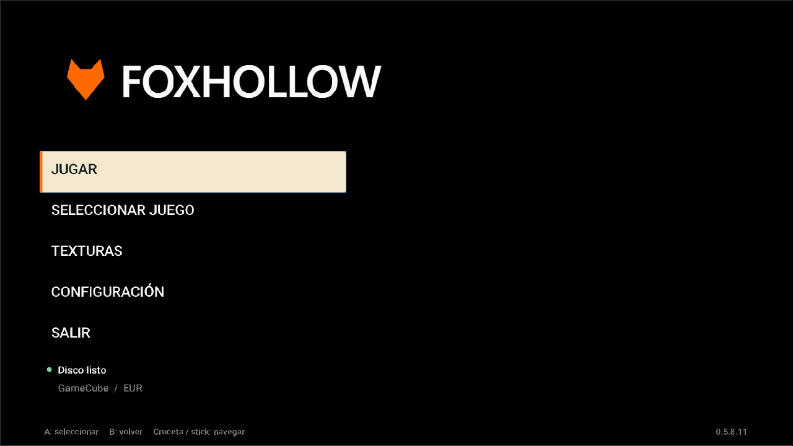

# Foxhollow UWP

Adaptación no oficial de **Star Fox Adventures** para **Xbox Series X|S en Developer Mode**, basada en [Foxhollow](https://github.com/JackPriceBurns/foxhollow), [SFA-Decomp](https://github.com/zcanann/SFA-Decomp) y [Aurora](https://github.com/encounter/aurora).

**Versión UWP: 0.5.8.16 · Estado: experimental.** Esta numeración es independiente de la del proyecto original. El paquete usa D3D12 y también puede instalarse en Windows para pruebas.

Necesitas tu propia copia del juego. El repositorio y los paquetes de distribución no incluyen discos, partidas ni recursos extraídos del juego.



## Funciones

- Selector de juegos desde USB: ISO, RVZ y GCM.
- Packs de texturas DDS/PNG desde ZIP en USB, con progreso, validación y activación opcional. Juego y audio pausados durante su preparación.
- Lectura directa del disco desde USB; guarda su ruta sin copiarlo a Xbox.
- Menú principal al abrir la app; durante la partida, View abre una barra superior con Configuración, Texturas y Salir.
- Fondo negro mientras no haya imagen del juego; menú transparente cuando el juego está visible.
- Resolución interna de 720p o 1080p; relación de aspecto 4:3 o 16:9.
- Idioma PAL: automático, inglés, francés, alemán, italiano o español.
- Contador opcional de FPS, tiempo medio por fotograma y pico de retraso.
- Ajustes persistentes, tarjetas de memoria por región y registro de diagnóstico.

## Instalar y jugar

Descarga el ZIP de instalación desde la sección Releases de este repositorio. El ZIP de código fuente sirve para desarrollar y no incluye el APPX.

1. Instala el APPX x64; proporciona la dependencia Microsoft VCLibs x64 si el sistema la solicita.
2. En Xbox Dev Home, configura **App type → Game** antes de iniciar Foxhollow.
3. Conecta una USB con tu disco y abre **SELECCIONAR JUEGO**.
4. Selecciona el archivo y espera la comprobación de compatibilidad. Mantén la USB conectada mientras juegas.
5. Selecciona **JUGAR**. Pulsa **View** durante la partida para abrir el menú.

La [guía de uso](docs/USAGE.md) explica la instalación en Xbox y Windows, las partidas y los errores conocidos.

Consulta [TEXTURES.md](docs/TEXTURES.md) para importar texturas desde el menú principal.

## Discos admitidos

| Región | ID | Revisión |
|---|---|---|
| USA | GSAE01 | 0 y 1 |
| Europa / PAL | GSAP01 | 0 y 1 |
| Japón | GSAJ01 | 0 |

Estos son los discos admitidos por el selector; no implica que todos hayan sido probados de principio a fin en Xbox. ISO, RVZ y GCM se leen directamente desde su ruta en USB mediante nod.

## Compilar

Requiere Windows x64, Visual Studio 2022 con herramientas C++ y UWP x64, Windows SDK, LLVM/clang-cl 20, CMake 3.25+, Ninja y Git.

```powershell
.\platforms\uwp\Build.ps1 -Mode Game -Package
```

Las dependencias UWP se descargan desde una revisión fijada de `SternXD/uwp-dep`. El APPX resultante debe firmarse antes de instalarlo. Consulta [BUILDING.md](docs/BUILDING.md).

## Estado de las pruebas

- **0.5.8.16 seleccionada para publicación tras la confirmación del usuario en Xbox.**
- APPX compilado localmente y firma verificada.
- Navegación con mando, activación y desactivación de texturas, pausa durante la preparación del pack y regresión del selector USB comprobadas en Windows.
- Pack HD completo extraído en Windows: 1703 texturas válidas; comprobados CRC, rutas inseguras, cancelación y conservación del pack anterior.
- Mantén **App type → Game** en Xbox. Los errores de memoria reportados anteriormente ocurrieron en modo App según el usuario.
- No se han comprobado todas las regiones, zonas del juego ni packs. Las capturas de esta documentación son vistas previas del menú.
- El workflow manual de GitHub Actions está preparado; todavía no se ha ejecutado en un runner remoto.

## Estructura

| Carpeta | Contenido |
|---|---|
| `platforms/uwp/` | Inicio, USB, menú, ajustes, almacenamiento y empaquetado UWP |
| `port/` | Compatibilidad con plataformas modernas |
| `game/` | Código de SFA-Decomp y procedencia en `VENDORED.txt` |
| `src/` | Entrada y soporte del port |
| `extern/` | Bibliotecas incluidas, con sus cambios locales y licencias |
| `docs/` | Uso, compilación, publicación, licencias y documentación original |
| `.github/workflows/` | Compilación manual del APPX sin firma |

Esta distribución incluye las bibliotecas modificadas como archivos normales; no requiere submódulos Git.

## Créditos

Véanse [CREDITS.md](CREDITS.md) y [THIRD_PARTY_NOTICES.md](THIRD_PARTY_NOTICES.md). Se conserva la licencia original de Foxhollow y los avisos propios de cada dependencia.

La estructura documental toma como referencia [Dusklight UWP](https://github.com/XboxEmulationHub/dusklight-uwp). Este proyecto no es una versión de Dusklight ni está afiliado a Nintendo, Rare o Microsoft.

## Publicar

El código fuente y los archivos de Release se preparan por separado. Consulta [PUBLICATION.md](docs/PUBLICATION.md). No se incluyen los workflows originales conectados al launcher de Foxhollow.
