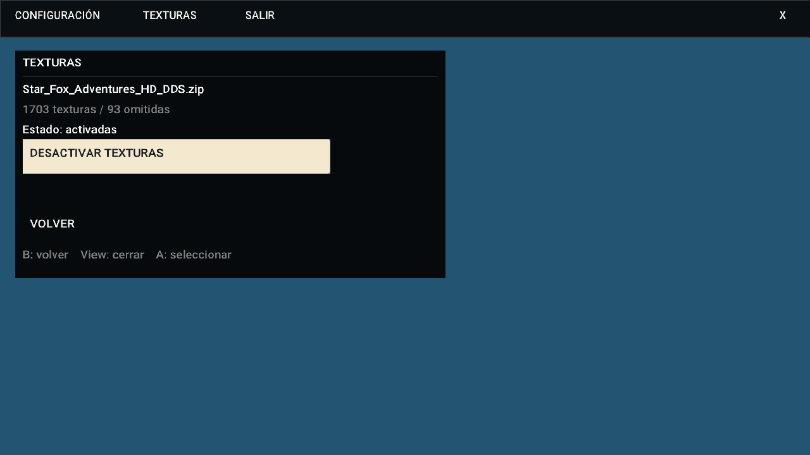

# Texturas desde USB

Disponible desde 0.5.8.11. La opción **TEXTURAS** aparece en el menú principal al abrir la aplicación. Durante la partida, desde 0.5.8.16 la barra ofrece Configuración, Texturas y Salir.

1. Copia el ZIP del pack a una USB reconocida por Xbox. No necesitas descomprimirlo.
2. Abre Foxhollow y selecciona **TEXTURAS**.
3. Entra en la unidad y selecciona el ZIP.
4. Espera las fases de copia, extracción y comprobación, y activación. Desde 0.5.8.15, el juego y el audio quedan pausados durante el proceso y el menú sigue respondiendo. No retires la USB durante la copia. Puedes cancelar.
5. Vuelve y selecciona **JUGAR**. El pack se guarda localmente y ya no necesita esa USB para cargar las texturas. La USB que contiene el disco debe permanecer conectada mientras juegas.

El pack nuevo queda habilitado. En TEXTURAS puedes desactivarlo o volver a activarlo. La selección se conserva y el motor actualiza sus reemplazos; no exige reiniciar la aplicación. Solo hay un pack activo a la vez. Los packs anteriores permanecen en almacenamiento.

## Formatos y validación

Se admiten ZIP normales con archivos almacenados o comprimidos mediante deflate. No se admiten ZIP cifrados, divididos o ZIP64. Las texturas deben utilizar nombres `tex1_*.dds` o `tex1_*.png` compatibles con Aurora. Esta función carga reemplazos de texturas; los mods de código siguen desactivados.

Se prefieren las carpetas GSA/GSAE01/GSAP01/GSAJ01 frente a alternativas del mismo ZIP. Se aplanan las subcarpetas y se omiten nombres repetidos. Se comprueban rutas, tamaño, CRC, cabeceras y datos completos de DDS. Los formatos aceptados incluyen BC1, BC3, BC5, BC7 y RGBA/BGRA admitidos por el cargador. El PNG se comprueba inicialmente por cabecera y dimensiones; el motor completa la decodificación.

Una importación cancelada o rechazada conserva la selección anterior. No se modifica el ZIP original, el disco ni las partidas. El log incluye advertencias sobre archivos omitidos.

## Prueba con Star_Fox_Adventures_HD_DDS.zip

El ZIP facilitado ocupa aproximadamente 1,43 GB. La selección validada contiene **1703 texturas** y ocupa aproximadamente **2,02 GB**. Se omiten **93 archivos**: 12 variantes de salud, 76 nombres repetidos, 4 nombres con sufijo incompatible y un DDS truncado:

`GSA/Dinosaur Planet/tex1_32x64_m_8b0a9a7ca4e00e93_14.dds`

Ese DDS contiene 41080 bytes frente a los 47184 necesarios para sus mipmaps. Se omite; la textura original del juego sigue disponible.

Reserva aproximadamente **4 GB libres** para importar este pack, porque durante el proceso coinciden el ZIP temporal y las texturas extraídas. Después se elimina el ZIP temporal. Añade espacio para el disco, las partidas y otros packs conservados.

La extracción del pack completo y las pruebas de importación, activación, CRC, rutas inseguras, cancelación y conservación del pack anterior se comprobaron en Windows. El usuario confirmó la versión 0.5.8.16 para publicación tras su prueba en Xbox. No se han comprobado todos los packs ni todas las zonas del juego. La caché de reemplazos UWP se limita a 512 MiB; ese límite no representa toda la memoria utilizada por la aplicación. Comienza con 720p y utiliza el contador de FPS para comparar el mismo recorrido con el pack activado y desactivado.

## Almacenamiento

Dentro de `LocalState/Foxhollow/`:

| Ruta | Función |
|---|---|
| `texture_packs/pack-.../` | Texturas instaladas |
| `texture-pack.ini` | Pack seleccionado y recuentos |
| `textures-disabled.flag` | Presente cuando el pack está desactivado |
| `texture-import.zip` | Copia temporal durante la importación |

No se incluye este pack en el repositorio ni en la distribución. Usa packs cuya distribución y uso tengas autorizados y conserva los créditos de su autor.

## Acceso denegado corregido en 0.5.8.14

La gestión de las carpetas utiliza Windows.Storage y la lectura/escritura utiliza SDL, sin resolver rutas mediante weakly_canonical. No requiere ampliar permisos de Xbox. Si el importador anterior mostró ese error, instala esta actualización y vuelve a seleccionar el ZIP. Comprueba el resultado de cada pack en consola.

La pausa comienza al seleccionar el ZIP, no al navegar por las carpetas. Al finalizar, cancelar o fallar, el juego continúa. El pack anterior se conserva si la importación falla o se cancela. Si todavía no se inició el juego, no se inicia mientras la preparación está en curso.

## Activar o desactivar mientras juegas

En la barra View/F1, abre TEXTURAS y selecciona el botón de activar/desactivar el pack instalado. Se guarda la selección y el motor actualiza los reemplazos sin reiniciar. El panel no permite importar otro ZIP durante la partida.

